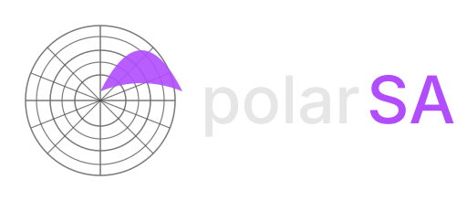
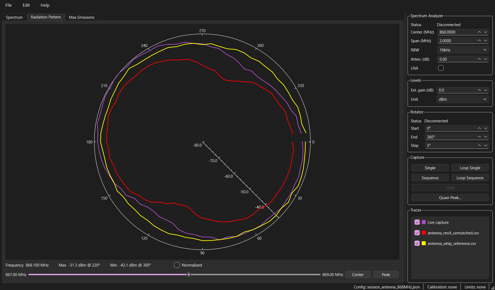
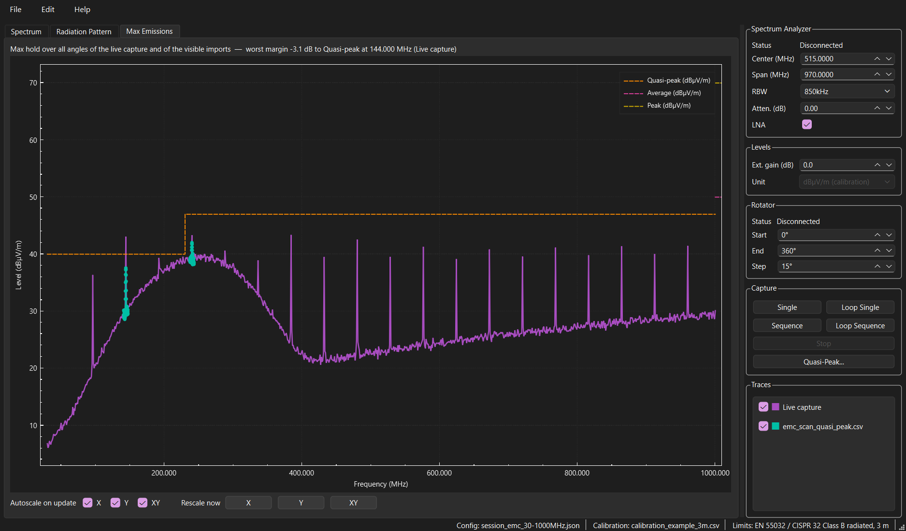
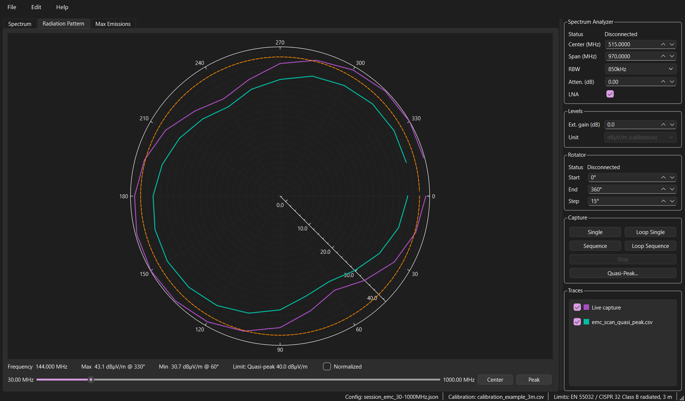
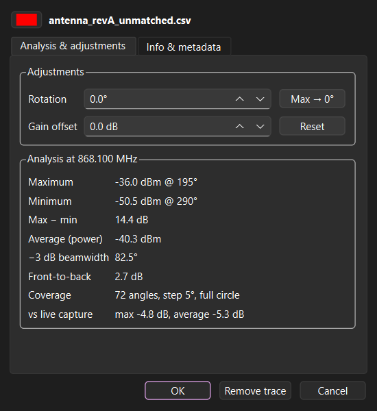
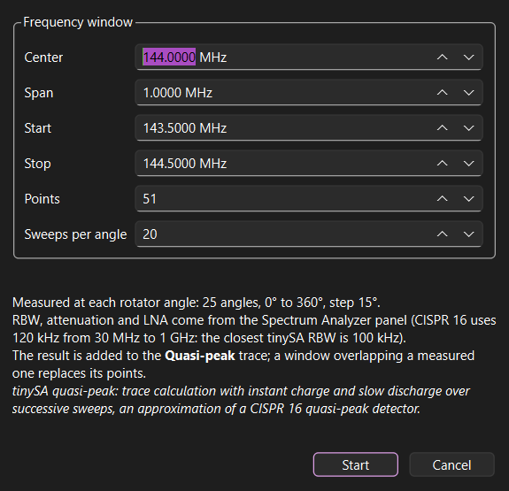
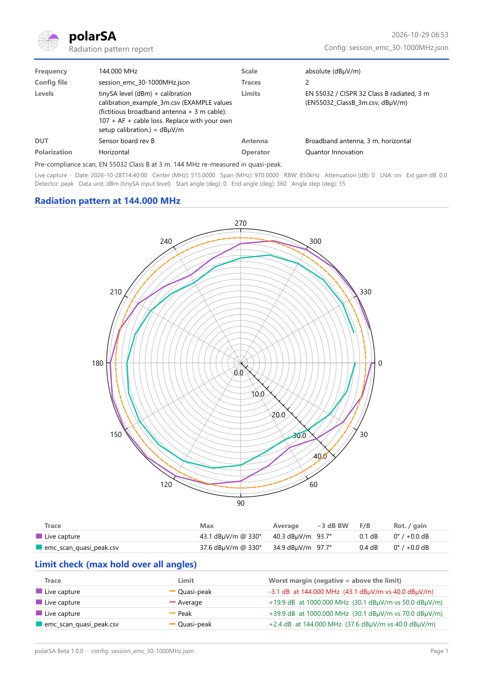

# polarSA

**polarSA** turns a **tinySA Ultra** spectrum analyzer and a **rotating DUT platform** into an antenna and EMC pre-compliance bench. It records the whole spectrum at every angle, then shows radiation patterns at any frequency, worst-case (max hold) emissions against EMC limits, and quasi-peak re-measurements, with low-cost, portable equipment.

---

## Features

**Radiation patterns**
- Full spectrum stored for every angle: browse the pattern at any frequency with the cursor (**Center**, **Peak**).
- Compare the live capture with any number of imported measurements, absolute or **Normalized**.
- Per-trace analysis (double-click a trace): max / min and their angle, average, −3 dB beamwidth, front-to-back, difference to the live capture; rotation and gain offset to align traces; color, metadata.

**EMC pre-compliance**
- **Max Emissions**: max hold over all angles of every trace, i.e. the worst-case emission spectrum.
- Levels in dBm, or in dBµV/m with a setup **calibration** (antenna factor + cable loss) or a coarse unit conversion.
- **Limits** shipped for EN 55032 / CISPR 32 and FCC Part 15, drawn on the spectra and as circles on the pattern, with the worst margin.
- **Quasi-peak** re-measurement of narrow windows around suspect peaks, at every angle, kept as a separate sparse trace.

**Capture, data and reports**
- Single / Loop Single sweeps, Sequence / Loop Sequence over the rotator angles (loops alternate the rotation direction).
- CSV export / import with measurement notes and settings; **PDF report** (pattern, analysis, limits check, max emissions, metadata) that can embed the trace data and be re-imported.
- Session **config** files (analyzer, rotator, levels, calibration and limits files).

| Max emissions, limits and quasi-peak | Emission pattern with the limit circle |
|---|---|
|  |  |

| Trace analysis | Quasi-peak window | PDF report |
|---|---|---|
|  |  |  |

---

## Try it without hardware

The [`examples/`](examples/) folder holds synthetic measurements (see its README):

- **Antenna comparison**: **File → Import Config...** `session_antenna_868MHz.json`, then **File → Import Trace(s)...** the three `antenna_*.csv` files, and move the cursor to 868.1 MHz.
- **EMC scan**: import `session_emc_30-1000MHz.json` (it loads the example calibration and the EN 55032 Class B 3 m limits), then `emc_scan_peak.csv` and `emc_scan_quasi_peak.csv`, and open the **Max Emissions** tab.

---

## Typical workflow

1. Connect the tinySA Ultra and the rotator over USB (the status shows *Connected*).
2. Set the analyzer (center, span, RBW, attenuation, LNA), the levels and the rotator angles, or import a config.
3. **Sequence**: the DUT turns and a sweep is recorded at each angle.
4. Browse patterns with the frequency cursor, check **Max Emissions** against the limits, re-measure suspect peaks with **Quasi-Peak...**.
5. **File → Export Trace / Export PDF Report**.

---

## Levels, calibration and limits

Displayed level = tinySA level (dBm) − external gain + conversion, applied to every trace for display, analysis and reports. Data files always keep the tinySA levels in dBm, with the settings in their metadata, so a measurement can be re-read later with another calibration.

- **Ext. gain**: preamplifier (+) or attenuator / cable loss (−) between the antenna and the tinySA.
- **Unit**: dBm, dBµV (+107 dB), dBµV/m (+107 dB + a flat antenna factor) or dB, when no calibration file is loaded.
- **Calibration** (optional, **File → Import Calibration...**): correction vs frequency, typically `107 + AF + cable loss` → dBµV/m. Format: [`calibration/README.md`](calibration/README.md).
- **Limits** (**File → Import Limits...**): ready-made files and format in [`limits/README.md`](limits/README.md). They are compared only when their unit matches the levels' unit, and are given for pre-compliance: check them against the applicable edition of the standard.

**Quasi-peak**: polarSA uses the tinySA's quasi-peak trace calculation (instant charge, slow discharge over successive sweeps), restarted at each angle. It approximates, but is not, a CISPR 16 quasi-peak detector, and it is slower than a normal sweep: use it on narrow windows.

---

## Files

- **Measurements** (CSV): `#` metadata lines (notes, analyzer and rotator settings, levels), a header row of frequencies in Hz, then one row per angle in dBm. `;` / tab separators and `,` decimals are accepted on import. PDF reports exported with embedded data can be imported too.
- **Configs** (JSON): settings only, no measurement data; calibration and limits files are stored relative to the config.
- **Calibration** and **limits** (CSV): see their folders.

---

## Hardware

- **tinySA Ultra** over USB, with an antenna (and optionally a preamplifier).
- **Rotator** over USB serial (Arduino-based turntable, 115200 baud): polarSA sends `set 0 <angle>` and waits for `reached <angle>` before each sweep. The turntable design will be published separately.
- Windows or Linux computer.

## Build

Qt 6 (Widgets, SerialPort, PrintSupport, OpenGL, Svg) with qmake: open `PolarSA.pro` in Qt Creator (MSVC 2022 or MinGW kit). On Windows, a Release build also assembles a standalone `deploy/` folder in the build directory (executable, Qt runtime, `limits/`, `calibration/`) with `deploy_win.bat`.

## Roadmap

- 3D radiation patterns, more scanning axes (currently 360° around Z).

## License

GPL v3.

## About

Designed and maintained by [Quantor Innovation](https://www.quantor.fr).
